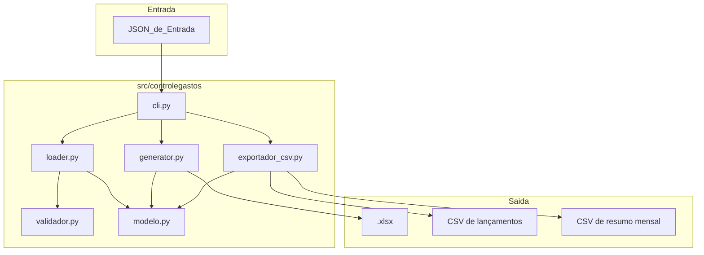
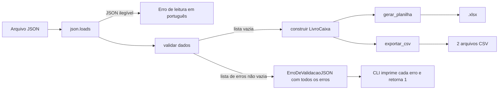
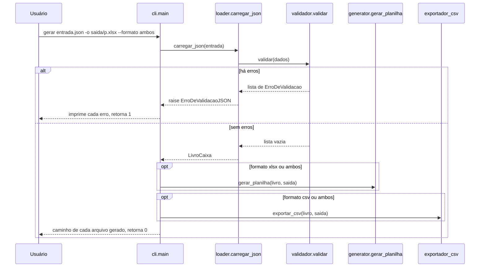

# Design Document

## Overview

Este documento descreve o design técnico para organizar o controleGastos para desenvolvimento assistido por IA no Kiro e para implementar as features do roadmap: (A) validação de schema, (B) exportação CSV e (E) gráficos extras. Importação de extratos bancários e **interface web estão fora do escopo** (adiadas; o Streamlit foi descartado). A numeração de requisitos e propriedades foi mantida porque os testes a citam.

O design foi escrito a partir da leitura do código real em `src/controlegastos` (`cli.py`, `loader.py`, `modelo.py`, `generator.py`), dos testes em `tests/` e do `AGENTS.md`. Fatos relevantes do código atual que condicionam as decisões:

- `loader.carregar_json(caminho)` lê o arquivo e constrói o `LivroCaixa` com `Decimal(str(valor))`; `dia` assume `1` e `categoria` assume `"geral"` quando ausentes; `date(ano, mes, dia)` levanta `ValueError` para dia inválido.
- `cli.main()` captura `(FileNotFoundError, KeyError, ValueError, TypeError)`, registra via `logger.error` e retorna `1`. Só existe o subcomando `gerar` com `entrada`, `-o/--saida` (padrão `saida/planilha.xlsx`) e `-v`.
- `generator.gerar_planilha(livros, destino)` cria `Resumo Geral`, uma aba `AAAA-MM` por mês e, se houver meses, a aba `Gráficos`. A Area_de_Apoio fica nas colunas `Q` a `U` (índice 17 a 21): tabela mensal a partir da linha 1 e, abaixo dela, a tabela de classes de investimento. A pizza está ancorada em `A2` e as barras em `A22`. Os valores gravados são `float(Decimal)`.
- Os testes existentes esperam `sheetnames == ["Resumo Geral", "2025-01", "2025-02", "Gráficos"]` para `exemplo.json` e `len(graficos._charts) >= 2`. Esses testes devem continuar passando.
- `pyproject.toml` usa `uv_build`, `requires-python >= 3.14`, grupo `dev` (pytest, ruff) e o script `controlegastos = "controlegastos:main"`. O CI roda `uv sync`, `ruff check .` e `pytest` em Python 3.14.

Decisões principais:

1. O Validador opera sobre o dicionário bruto do JSON (antes de construir o `LivroCaixa`) e devolve uma lista de erros, sem lançar na primeira falha.
2. O Loader ganha uma função `carregar_dados(dados)` que valida e constrói; `carregar_json` passa a ler o arquivo e delegar para ela. A assinatura pública de `carregar_json` não muda.
3. Os gráficos novos reutilizam a Area_de_Apoio estendida para a direita (colunas `W` em diante), sem alterar as tabelas e os gráficos existentes.
4. O contexto para IA é o `AGENTS.md` (fonte única, curto). Agentes e hooks são só configuração; os hooks chamam `scripts/checar.py` para serem portáveis entre Windows e Linux.

## Architecture

### Visão de módulos



Regras de dependência:

- `validador.py` não importa nenhum outro módulo do pacote e usa só a biblioteca padrão (Requirement 8.1).
- `modelo.py` permanece sem mudanças.

### Fluxo de dados



### Fluxo do subcomando gerar



## Components and Interfaces

### validador.py

Módulo só com biblioteca padrão (`calendar`, `dataclasses`, `math`).

```python
@dataclass(frozen=True, slots=True)
class ErroDeValidacao:
    caminho: str      # ex.: "anos[0].meses[2].despesas[1].valor"
    mensagem: str     # português, ex.: "valor deve ser numérico (não booleano)"

    def __str__(self) -> str:
        return f"{self.caminho}: {self.mensagem}"

TIPOS_DE_INVESTIMENTO_CONHECIDOS: frozenset[str] = frozenset({"renda_fixa", "fii", "cripto"})

def validar(dados: object) -> list[ErroDeValidacao]:
    """Percorre todo o documento e devolve todos os erros. Lista vazia = válido."""
```

Contrato:

- `validar` nunca lança por causa do conteúdo do documento. Qualquer tipo inesperado vira um `ErroDeValidacao`.
- Se a raiz não é objeto, o único erro tem `caminho == "(raiz)"`.
- O Caminho_do_Erro usa o formato `campo[indice].campo`, com índices base 0 (Requirement 8.8). Para campo obrigatório ausente, o caminho aponta para o campo ausente (ex.: `anos[0].meses[2].despesas[1].valor`).
- As regras são aplicadas por nível, e o erro de um nível não esconde erros de níveis independentes:

| Regra | Onde | Requisito |
|---|---|---|
| `anos` presente e é lista | raiz | 8.2 |
| `ano` presente e inteiro (não booleano); `meses` presente e é lista | cada ano | 8.2 |
| `mes` inteiro (não booleano) entre 1 e 12 | cada mês | 8.3 |
| `salario` e `meta_investimento`, se presentes, numéricos finitos e não booleanos | cada mês | 8.5 |
| `receitas`, `despesas`, `investimentos`, se presentes, são listas de objetos | cada mês | 8.7 |
| `descricao` (texto), `valor`, `dia` presentes em receitas e despesas | cada lançamento | 8.7 |
| `tipo`, `descricao`, `valor`, `dia` presentes em investimentos | cada investimento | 8.7 |
| `valor` numérico finito e não booleano | cada lançamento | 8.5 |
| `dia` inteiro (não booleano) válido para ano e mês, com 29/02 só em ano bissexto (`calendar.monthrange`) | cada lançamento | 8.4 |
| `tipo` pertence a `TIPOS_DE_INVESTIMENTO_CONHECIDOS` | cada investimento | 8.6 |

Decisões de detalhe:

- "Numérico" significa `int` ou `float` com `math.isfinite`, excluindo `bool`. Strings numéricas como `"10.5"` são rejeitadas, porque o Loader hoje converte via `Decimal(str(valor))` e o contrato do JSON usa números.
- A validação do `dia` só roda se `ano` e `mes` do contexto forem válidos. Se o mês é inválido, apenas o erro do mês é reportado para os lançamentos dele, evitando erros em cascata sem informação.
- O `ano` precisa ser inteiro entre 1 e 9999 para que `date(ano, mes, dia)` seja construível. A faixa é uma extensão dos requisitos, necessária para o Loader não falhar depois da validação.
- Tipos desconhecidos em `tipo` são erro (Requirement 8.6), mesmo que `generator.py` conheça o alias `fiis`/`criptomoedas` em `_TIPO_LABEL`. O JSON documentado aceita apenas `renda_fixa`, `fii` e `cripto`.
- Campos opcionais de texto (`categoria`, `ativo`), se presentes, precisam ser texto. Essa regra é uma extensão para evitar `TypeError` depois da validação.

### loader.py

Mudanças:

```python
class ErroDeValidacaoJSON(ValueError):
    """Levantada quando o JSON de entrada tem um ou mais erros de schema."""
    def __init__(self, erros: list[ErroDeValidacao]) -> None:
        self.erros = erros
        super().__init__(f"{len(erros)} erro(s) de validação")

def carregar_dados(dados: object) -> LivroCaixa:
    erros = validar(dados)
    if erros:
        raise ErroDeValidacaoJSON(erros)
    return _construir_livro(dados)          # corpo atual de carregar_json, sem mudanças de lógica

def carregar_json(caminho: str | Path) -> LivroCaixa:
    dados = json.loads(Path(caminho).read_text(encoding="utf-8"))
    return carregar_dados(dados)
```

- `ErroDeValidacaoJSON` herda de `ValueError`. Assim, código que já captura `ValueError` continua funcionando, mas o `cli` captura a subclasse antes para listar todos os erros (Requirement 8.10, 8.11).
- `json.JSONDecodeError` já é `ValueError` e continua tratado pelo caminho genérico do CLI. A mensagem passa a ser em português: `JSON inválido na linha X, coluna Y: ...`.
- Como o Validador exige `dia`, `descricao` e `valor`, os valores padrão atuais do Loader (`dia=1`) passam a ser inalcançáveis para entradas válidas. Eles permanecem como defesa, sem custo.

### cli.py

Mudanças:

```python
# subcomando gerar
gerar.add_argument("--formato", choices=["xlsx", "csv", "ambos"], default="xlsx",
                   help="Formato de saída: xlsx (padrão), csv ou ambos.")
```

Tratamento de erros em `main()`:

```python
try:
    livros = carregar_json(args.entrada)
except ErroDeValidacaoJSON as erro:
    logger.error("O arquivo de entrada tem %d erro(s):", len(erro.erros))
    for item in erro.erros:
        logger.error("  - %s", item)          # uma linha por erro, com Caminho_do_Erro
    return 1
except (FileNotFoundError, KeyError, ValueError, TypeError) as erro:
    logger.error("Falha ao processar os dados: %s", erro)
    return 1
```

- Nenhum arquivo é escrito quando há erros de validação, porque a geração só começa depois do carregamento (Requirement 8.11, 8.12).
- `--formato` com valor inválido: o `argparse` já encerra com código `2` e mensagem de uso. Para atender o Requirement 9.11 (mensagem em português), o parser usa `choices` e `ArgumentParser` com mensagem localizada via subclasse que sobrescreve `error()` para prefixar `Valor inválido para --formato. Use: xlsx, csv ou ambos.`. O código de saída `2` satisfaz "diferente de 0".
- Formato `xlsx` (padrão) mantém o comportamento atual e a saída `Planilha disponível em: ...` (Requirement 9.2). Para `csv` e `ambos`, o CLI imprime uma linha `Arquivo disponível em: <caminho>` por arquivo gerado (Requirement 9.12).
### exportador_csv.py

```python
CABECALHO_LANCAMENTOS = ["data", "tipo", "descricao", "categoria", "ativo", "valor"]
CABECALHO_RESUMO = ["ano", "mes", "receitas", "despesas", "investimentos", "saldo_livre"]

def caminhos_csv(destino_base: str | Path) -> tuple[Path, Path]:
    """Deriva os dois nomes a partir de -o."""

def formatar_decimal(valor: Decimal) -> str:
    """Quantiza para duas casas (ROUND_HALF_UP) e formata com ponto: '1234.50'."""

def exportar_csv(livros: LivroCaixa, destino_base: str | Path) -> tuple[Path, Path]:
    """Cria o diretório se necessário e grava os dois CSV em UTF-8. Retorna os caminhos."""

def linhas_lancamentos(livros: LivroCaixa) -> list[list[str]]: ...
def linhas_resumo(livros: LivroCaixa) -> list[list[str]]: ...
```

Nomes de arquivo (derivados de `-o`, usando o nome sem extensão):

| `-o` | CSV_de_Lancamentos | CSV_de_Resumo_Mensal |
|---|---|---|
| `saida/planilha.xlsx` | `saida/planilha-lancamentos.csv` | `saida/planilha-resumo-mensal.csv` |
| `saida/jan` (sem extensão) | `saida/jan-lancamentos.csv` | `saida/jan-resumo-mensal.csv` |

A regra é `destino.with_name(f"{destino.stem}-lancamentos.csv")` e `destino.with_name(f"{destino.stem}-resumo-mensal.csv")`. O diretório pai é criado com `mkdir(parents=True, exist_ok=True)` (Requirement 9.10).

CSV_de_Lancamentos:

- Cabeçalho exato: `data,tipo,descricao,categoria,ativo,valor`.
- `data`: `AAAA-MM-DD` (`date.isoformat()`), Requirement 9.7.
- `tipo`: `receita`, `despesa` ou `investimento`, Requirement 9.8.
- `categoria`: valor de `categoria` do modelo. Para investimentos é o valor carregado (padrão `geral`); `tipo` do investimento (renda_fixa etc.) **não** vai para esta coluna.
- `ativo`: preenchido só para investimentos; vazio para receitas e despesas.
- `valor`: `Decimal` quantizado com duas casas e ponto, sem separador de milhar, ex.: `1200.00`. Nunca `float`.
- Ordem das linhas: por ano, mês, depois receitas, despesas e investimentos, mantendo a ordem de inserção do modelo dentro de cada grupo. O salário aparece como receita `Salário` com categoria `salario`, exatamente como o Loader a cria.

CSV_de_Resumo_Mensal:

- Cabeçalho exato: `ano,mes,receitas,despesas,investimentos,saldo_livre`.
- Uma linha por mês, ordenada por ano e mês. `mes` é inteiro de 1 a 12.
- Os totais vêm de `Mes.total_receitas`, `total_despesas`, `total_investimentos` e `saldo_livre`, o que garante a convenção `receitas - despesas - investimentos` e a igualdade com o Resumo Geral (Requirement 9.9). Quantização ocorre apenas na formatação, nunca antes da soma.
- O Resumo Geral grava `float(valor)` com formato `#,##0.00`. Para valores de entrada com até duas casas decimais, a representação de duas casas coincide com a do CSV. Para entradas com mais casas, a comparação nos testes é feita após arredondar ambos a duas casas.

Codificação e formato de arquivo:

- Escrita com `open(..., "w", encoding="utf-8", newline="")` e `csv.writer(..., lineterminator="\n")`. Sem BOM e com vírgula como delimitador, porque o requisito fixa ponto decimal. O Excel em pt-BR pode exigir importação com delimitador explícito; isso é uma limitação conhecida e documentada no README, não um defeito.

### generator.py: gráficos extras

A função `_renderizar_graficos` continua criando a aba `Gráficos` somente quando há meses. Ela passa a chamar três funções auxiliares depois de criar os gráficos existentes (que não mudam: pizza em `A2` e barras mensais em `A22`).

Funções puras para os dados (testáveis sem openpyxl):

```python
def _patrimonio_acumulado(livros) -> list[tuple[str, Decimal]]:
    """[(AAAA-MM, soma acumulada de total_investimentos até o mês)], em ordem cronológica."""

def _ranking_despesas(livros) -> list[tuple[str, Decimal]]:
    """[(categoria, total)] em ordem decrescente de total; desempate por nome."""

def _variacao_saldo(livros) -> list[tuple[str, Decimal]]:
    """[(AAAA-MM, saldo_livre do mês - saldo_livre do mês anterior)] a partir do 2º mês."""
```

Extensão da Area_de_Apoio (colunas à direita da existente, que ocupa `Q`..`U`):

| Bloco | Colunas | Conteúdo |
|---|---|---|
| Patrimônio | `W`, `X` | `Mês`, `Patrimônio acumulado` |
| Ranking de despesas | `Z`, `AA` | `Categoria`, `Total` (linha 1 = cabeçalho) |
| Comparativo | `AC`, `AD` | `Mês`, `Variação do saldo livre` |

Todas gravam `float(valor)` com `number_format = "#,##0.00"`, como o resto da Area_de_Apoio, e as larguras de coluna são configuradas como as existentes.

Gráficos (todos com openpyxl, sem dependência nova, Requirement 11.5):

| Gráfico | Tipo openpyxl | Âncora | Condição para existir |
|---|---|---|---|
| Evolução do patrimônio | `LineChart` com marcadores, categorias = meses | `A42` | pelo menos 2 meses e total de investimentos maior que zero |
| Ranking de categorias de despesa | `BarChart` com `type = "bar"` (horizontal); eixo de categorias com `scaling.orientation = "maxMin"` para exibir a maior primeira; limitado às 10 maiores categorias no gráfico (a tabela de apoio traz todas) | `A62` | pelo menos 1 despesa |
| Comparativo entre meses | `BarChart` `type = "col"` com a variação do saldo livre em relação ao mês anterior | `A82` | pelo menos 2 meses |

Decisões:

- "Patrimônio" é o **acumulado dos aportes** em investimentos, sem rendimentos, porque o modelo só registra valores aplicados. O título do gráfico diz `Evolução do patrimônio (aportes acumulados)`.
- "Comparativo entre meses" foi definido como a variação do saldo livre mês a mês. Assim ele traz informação distinta do gráfico de barras existente, que já mostra receitas, despesas, investimentos e saldo por mês.
- **Rótulo `Sem categoria`**: o Loader aplica `"geral"` quando `categoria` está ausente, então para o ranking uma despesa é considerada sem categoria quando `categoria.strip()` é vazio ou igual a `"geral"` (valor padrão do Loader). Todas essas despesas são somadas sob `Sem categoria`. Efeito colateral aceito: uma categoria que o usuário nomeou literalmente `geral` também cai nesse rótulo. A alternativa seria mudar o padrão do Loader, o que alteraria o comportamento de outras partes; por isso não foi adotada.
- **Dados insuficientes**: cada gráfico é criado só se sua condição for satisfeita; a tabela de apoio correspondente também só é escrita nesse caso. Nenhum erro é lançado (Requirement 11.7). A aba `Gráficos` continua existindo apenas se houver meses, como hoje.
- Os gráficos existentes e o teste `len(graficos._charts) >= 2` permanecem válidos. Para `exemplo-completo.json` espera-se 5 gráficos; a premissa de que esse arquivo tem pelo menos 2 meses, despesas e investimentos deve ser confirmada na tarefa de teste (Requirement 11.9).
- As imagens em `docs/media` são regeneradas manualmente a partir de `exemplo-completo.json` (dados fictícios) numa tarefa de documentação (Requirement 11.10).

### Organização para IA (.kiro)

Só Markdown e JSON de configuração; nenhum código de produto além de `scripts/checar.py`.

- **Contexto**: `AGENTS.md` (~100 linhas) é a fonte única e o Kiro o carrega sozinho. Os antigos steerings `produto`, `tech`, `estrutura` e `convencoes` foram removidos por duplicarem o AGENTS.md. Resta o steering manual `revisar-documentacao.md`.
- **Agentes** (`.kiro/agents/*.md`, front matter com `permissions.rules`):

| Agente | Escreve em | Observação |
|---|---|---|
| `planejador` | `.kiro/specs/**` | Não altera código |
| `implementador` | tudo, exceto `.kiro/**`, `.github/**` e `AGENTS.md` | Sem `git commit/add/push`; o commit é do agente principal |
| `qa` | `tests/**` | Roda ruff e pytest e relata |
| `documentacao` | `README.md`, `AGENTS.md`, `docs/**` | Mantém o AGENTS.md curto |

- **Hooks** (`.kiro/hooks/*.json`, `version: "v1"`):
  - `checar-ao-salvar`: `PostFileSave` em `.py` de `src/` ou `tests/`; executa `uv run python scripts/checar.py` (ruff em tudo, pytest só do módulo alterado, ou suíte inteira se o arquivo não for identificado). Sem `&&`, `;` ou `$LASTEXITCODE`, logo funciona em qualquer shell.
  - `lembrete-esquema`: `PostFileSave` em `loader.py`, `validador.py` e `exemplo*.json`; lembra de atualizar o esquema em conjunto.
- A revisão de documentação não é hook (o Kiro não tem gatilho manual); é o steering manual `/revisar-documentacao`.
- Risco conhecido: não foi confirmado que o Kiro aplica `permissions.rules` dos agentes; o `AGENTS.md` repete as regras como defesa.

### CI (`.github/workflows/ci.yml`)

- Um único job com `uv sync`, `uv run ruff check .` e `uv run pytest` em Python 3.14. Não há dependências opcionais.
- `ruff check .` já cobre os módulos novos por estar no diretório raiz.

## Data Models

Não há mudança em `modelo.py`. Os novos tipos são:

```python
@dataclass(frozen=True, slots=True)
class ErroDeValidacao:           # validador.py
    caminho: str
    mensagem: str

class ErroDeValidacaoJSON(ValueError):   # loader.py
    erros: list[ErroDeValidacao]
```

Esquema do JSON de entrada: sem mudança em relação ao `AGENTS.md`. O que muda é que as regras antes implícitas (campos obrigatórios, tipos, intervalos) agora são verificadas e documentadas.

Exemplo de CSV_de_Lancamentos:

```csv
data,tipo,descricao,categoria,ativo,valor
2025-01-01,receita,Salário,salario,,5000.00
2025-01-05,despesa,Aluguel,moradia,,1200.00
2025-01-10,investimento,Reserva de emergência,geral,CDI,1000.00
```

Exemplo de CSV_de_Resumo_Mensal:

```csv
ano,mes,receitas,despesas,investimentos,saldo_livre
2025,1,5250.00,1780.00,1000.00,2470.00
```

(Os valores do exemplo seguem os totais afirmados em `tests/test_loader.py` para `exemplo.json` em janeiro de 2025. Os lançamentos individuais acima são ilustrativos.)

## Correctness Properties

*A property is a characteristic or behavior that should hold true across all valid executions of a system-essentially, a formal statement about what the system should do. Properties serve as the bridge between human-readable specifications and machine-verifiable correctness guarantees.*

As propriedades abaixo foram derivadas das regras testáveis dos Requirements 8 a 11, depois de uma reflexão para eliminar redundância. As regras individuais do Requirement 8 (campos obrigatórios, intervalo de mês, dia, tipo numérico, tipo de investimento) foram unificadas na Property 2 (injeção de uma violação), e a UTF-8, o formato decimal, a data e o `tipo` do CSV foram unificados na Property 5 (round trip). Os critérios sobre steering, agentes, hooks, reorganização do workspace, instalação de ferramentas e documentação não são propriedades; são verificados por exemplos ou pelo próprio fluxo operacional.

### Property 1: Documentos válidos não geram erros

*For any* documento JSON gerado a partir do esquema válido (anos, meses de 1 a 12, dias válidos para o mês e o ano, valores numéricos finitos, tipos de investimento conhecidos, campos obrigatórios presentes), o Validador devolve uma lista vazia, e os arquivos `exemplo.json` e `exemplo-completo.json` também são aceitos.

**Validates: Requirements 8.2, 8.3, 8.4, 8.5, 8.6, 8.7, 8.13**

### Property 2: Uma violação injetada é reportada no caminho correto

*For any* documento válido e qualquer violação injetada em uma posição conhecida (campo obrigatório removido, `mes` fora de 1 a 12, `dia` inválido incluindo 29/02 em ano não bissexto, `valor`, `salario` ou `meta_investimento` não numérico ou booleano, `tipo` de investimento desconhecido), o Validador reporta ao menos um erro cujo `caminho` é exatamente o Caminho_do_Erro dessa posição, com mensagem em português não vazia.

**Validates: Requirements 8.2, 8.3, 8.4, 8.5, 8.6, 8.7, 8.8**

### Property 3: Todos os erros são reportados em uma única execução

*For any* documento válido e qualquer conjunto de k violações injetadas em posições distintas e independentes, uma única chamada a `validar` devolve erros cujos caminhos incluem os k caminhos injetados.

**Validates: Requirements 8.9**

### Property 4: Entrada inválida é rejeitada antes da construção e o CLI retorna 1

*For any* documento com ao menos um erro de schema, `carregar_dados` levanta `ErroDeValidacaoJSON` contendo exatamente os erros de `validar`, e o `main` da CLI retorna 1, imprime todas as mensagens e não cria arquivos de saída. *For any* documento válido, `main` retorna 0 e gera o arquivo.

**Validates: Requirements 8.10, 8.11, 8.12**

### Property 5: Round trip do CSV de lançamentos

*For any* `LivroCaixa` (incluindo descrições e categorias com vírgulas, aspas, quebras de linha e caracteres Unicode), ler o CSV_de_Lancamentos como UTF-8 e reconstruir as linhas produz cabeçalho exato `data,tipo,descricao,categoria,ativo,valor`, uma linha por lançamento do modelo, `data` em `AAAA-MM-DD`, `tipo` em `{receita, despesa, investimento}`, texto idêntico ao do modelo e `valor` com exatamente duas casas decimais e ponto, igual ao valor do modelo quantizado em duas casas.

**Validates: Requirements 9.3, 9.5, 9.6, 9.7, 9.8**

### Property 6: Totais do CSV de resumo coincidem com o modelo e com o Resumo Geral

*For any* `LivroCaixa`, cada linha do CSV_de_Resumo_Mensal tem receitas, despesas, investimentos e saldo_livre iguais (em duas casas) aos totais do `Mes` correspondente, `saldo_livre = receitas - despesas - investimentos`, e o saldo é igual ao valor da coluna Saldo Livre do Resumo Geral da planilha gerada para o mesmo mês.

**Validates: Requirements 9.4, 9.9**

### Properties 7 a 9 (suspensas)

Eram da interface web (salvar e recarregar, dados inválidos nunca geram arquivos, conteúdo ilegível não altera a sessão). Os números ficam reservados.

### Property 10: Ranking de despesas ordenado, completo e com rótulo padrão

*For any* `LivroCaixa`, o ranking de categorias de despesa está em ordem decrescente de total, a soma dos totais é igual ao total de despesas do livro, e toda despesa com categoria vazia, composta só de espaços ou igual a `geral` é contada sob o rótulo `Sem categoria`.

**Validates: Requirements 11.2, 11.6**

### Property 11: Patrimônio acumulado é a soma cumulativa dos aportes

*For any* `LivroCaixa`, a série de evolução do patrimônio tem um ponto por mês em ordem cronológica, cada valor é a soma de `total_investimentos` dos meses até aquele ponto (portanto não decrescente) e o último valor é igual ao total de investimentos do livro.

**Validates: Requirements 11.1**

### Property 12: Gerar a planilha nunca falha por dados insuficientes

*For any* `LivroCaixa`, inclusive vazio, com um único mês ou sem despesas e sem investimentos, `gerar_planilha` conclui sem lançar exceção e a aba `Gráficos` contém somente os gráficos cujas condições de dados são satisfeitas, mantendo a pizza e as barras mensais existentes quando há meses.

**Validates: Requirements 11.3, 11.7, 11.8**

## Error Handling

| Situação | Detecção | Tratamento | Saída ao usuário |
|---|---|---|---|
| Arquivo de entrada inexistente | `FileNotFoundError` em `carregar_json` | CLI captura, retorna 1 | `Falha ao processar os dados: ...` |
| JSON malformado | `json.JSONDecodeError` (`ValueError`) | CLI captura, retorna 1 | Mensagem em português com linha e coluna |
| Raiz do JSON não é objeto | `validar` | Erro com caminho `(raiz)` | Lista de erros |
| Erros de schema | `validar` | `ErroDeValidacaoJSON`; CLI imprime todos e retorna 1 | Um erro por linha com Caminho_do_Erro |
| `--formato` inválido | `argparse` `choices` | Mensagem em português, código 2 | `Valor inválido para --formato. Use: xlsx, csv ou ambos.` |
| Diretório de destino inexistente | `exportador_csv` e `gerar_planilha` | `mkdir(parents=True, exist_ok=True)` | Nenhuma |
| Erro de escrita (permissão, arquivo aberto no Excel) | `OSError` na gravação | A CLI passa a capturar `OSError` junto aos tipos atuais e retorna 1; os dois CSV são gravados de forma que falha no segundo não deixa a CLI reportar sucesso | `Falha ao gravar o arquivo: ...` |
| Dados insuficientes para gráfico | Condição de dados no gerador | Gráfico omitido, sem erro | Nenhuma |

Princípios: mensagens ao usuário em português; nunca engolir erro em silêncio; nenhuma gravação parcial depois de falha de validação, porque a validação ocorre antes de qualquer escrita.

## Riscos

| Risco | Impacto | Mitigação |
|---|---|---|
| `exemplo.json` ou `exemplo-completo.json` podem não satisfazer as novas regras (por exemplo, itens sem `dia`, que o Loader tolera hoje) | Requirement 8.13 falharia | Primeiro teste da tarefa de validação roda o Validador nos dois exemplos; se falhar, corrigir os exemplos na mesma mudança (regra de atualização conjunta) |
| Validação mais estrita que o Loader atual (strings numéricas, `dia` obrigatório) | Entradas antes aceitas passam a ser rejeitadas | Mensagens claras com caminho; registrar a mudança no `AGENTS.md` e no `README.md` |
| Categoria padrão `geral` do Loader versus rótulo `Sem categoria` | Categoria literal `geral` aparece como `Sem categoria` | Decisão documentada acima; revisitar se o usuário quiser mudar o padrão do Loader |
| Âncoras dos gráficos novos sobrepondo conteúdo | Gráficos ilegíveis | Âncoras `A42`, `A62`, `A82` abaixo dos existentes e longe da Area_de_Apoio (colunas `Q` em diante); conferir visualmente ao regenerar `docs/media` |
| Kiro ignorar `permissions.rules` dos agentes ou o formato dos hooks | Regras não aplicadas | Regras repetidas no `AGENTS.md`; hooks sem sintaxe de shell |
| Excel pt-BR abre CSV com vírgula e ponto de forma diferente | Dados aparecem em uma coluna só | Documentar no README a importação com delimitador explícito; formato fixado pelo requisito |

## Testing Strategy

Abordagem dupla: testes unitários (exemplos, bordas e integração) e testes de propriedades (entradas geradas). Os dois são complementares. Testes são determinísticos e não dependem de rede nem de dados pessoais.

**Biblioteca de propriedades**: `hypothesis`, adicionada ao grupo `dev` do `pyproject.toml` (`uv add --dev hypothesis`, com versão pinada). Cada teste de propriedade usa no mínimo 100 exemplos (`@settings(max_examples=100)`) e traz o comentário `# Feature: controlegastos-agentes-ia, Property N: <título>`. Cada propriedade da seção anterior é implementada por **um** teste.

**Geradores (estratégias Hypothesis)**:

- `documentos_validos()`: constrói dicionários do esquema com anos, meses 1 a 12, dias escolhidos dentro de `calendar.monthrange`, valores `Decimal` com duas casas convertidos para `float` ou `int` JSON, tipos de investimento do conjunto conhecido, textos Unicode, incluindo vírgulas, aspas e quebras de linha.
- `violacoes()`: funções que alteram um documento válido em um caminho conhecido e devolvem o Caminho_do_Erro esperado.
- `livros_caixa()`: construídos via `carregar_dados(documentos_validos())`, incluindo livros vazios, com um mês e sem despesas.

**Testes unitários e de exemplo**:

| Área | Casos |
|---|---|
| `validador` | Um caso válido e um inválido por regra dos critérios 8.2 a 8.7; 29/02 em 2024 (válido) e 2025 (inválido); `exemplo.json` e `exemplo-completo.json` sem erros; raiz que não é objeto; booleano em `valor` |
| `loader` | `carregar_json` continua passando nos testes existentes; `ErroDeValidacaoJSON` carrega todos os erros |
| `cli` | `--formato` padrão gera só o xlsx; `csv` gera os dois CSV; `ambos` imprime 3 caminhos; valor inválido de `--formato` sai com código diferente de 0; entrada inválida retorna 1 e imprime todas as mensagens (usando `caplog`) |
| `exportador_csv` | Cabeçalhos exatos; `Decimal("1200")` vira `1200.00`; arredondamento half-up; diretório criado; arquivo decodifica como UTF-8; derivação dos nomes a partir de `-o` |
| `generator` | Para `exemplo-completo.json`, a aba `Gráficos` tem 5 gráficos; para livro com um mês, tem somente pizza e barras; testes existentes permanecem verdes |

**Testes por propriedade** (Properties 1 a 12): implementados com Hypothesis conforme descrito acima. A Property 6 gera a planilha em `tmp_path`, lê o Resumo Geral com `openpyxl` e compara o saldo arredondado a duas casas. As Properties 10 e 11 testam as funções puras `_ranking_despesas` e `_patrimonio_acumulado`.

**Verificações fora do pytest**:

- Agentes e hooks: conferência manual (4 agentes, 2 hooks, `scripts/checar.py` exercitado com entradas simuladas).
- Fechamento: `uv run pytest`, `uv run ruff check .` e geração ponta a ponta `uv run controlegastos gerar data/entradas/exemplo-completo.json -o saida/planilha.xlsx --formato ambos`, com verificação de existência do `.xlsx` e dos dois CSV.

**Fora de escopo**: importação de extratos bancários; interface web; rendimentos de investimentos no gráfico de patrimônio.
