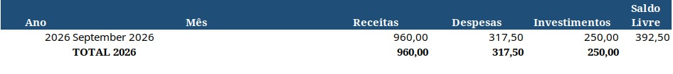
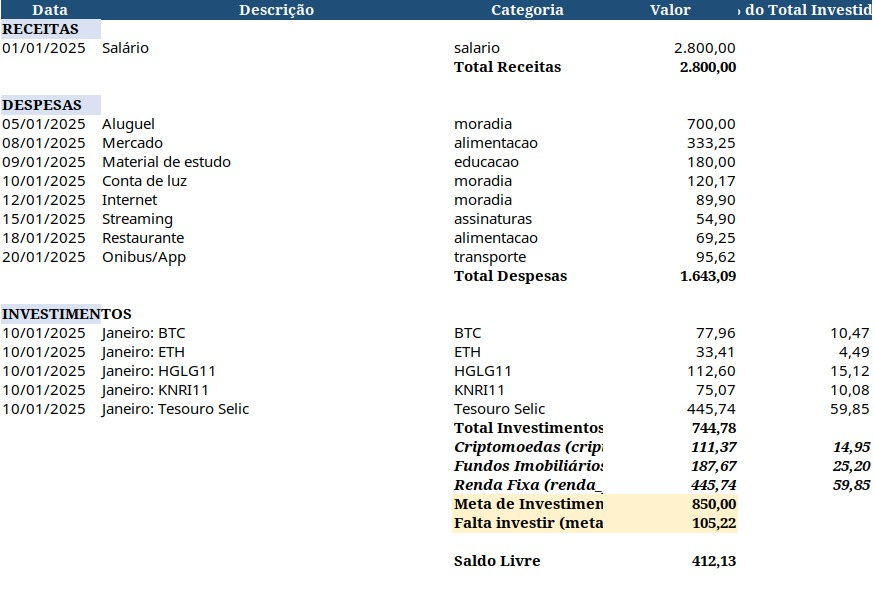
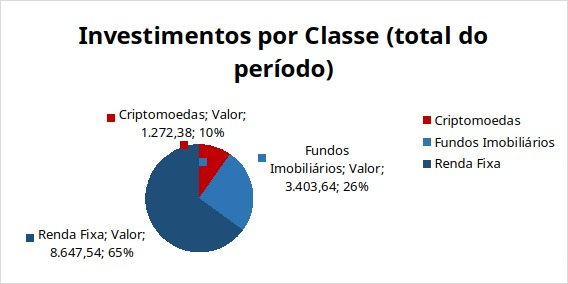
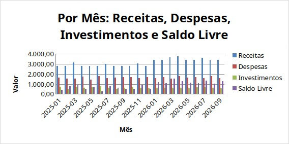
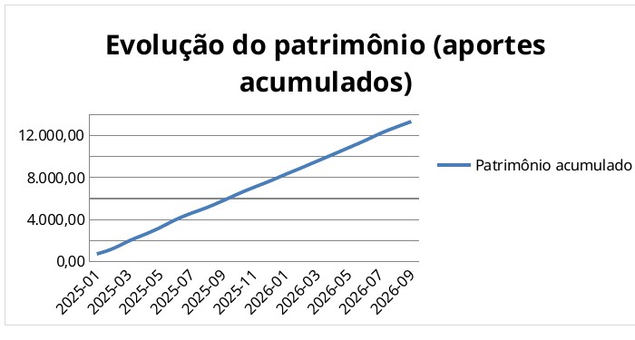
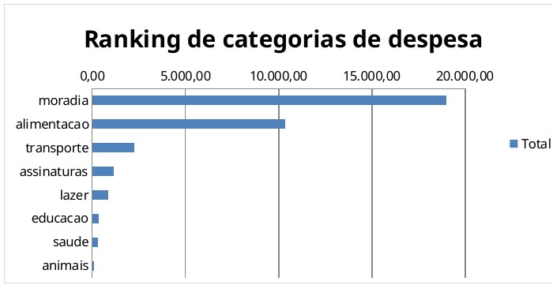
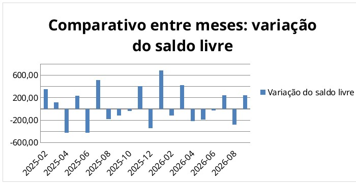

# controleGastos


Ferramenta de **controle de gastos pessoais** que gera planilhas Excel (.xlsx) e arquivos CSV organizando **receitas**, **despesas** e **investimentos** por mês e por ano. Funciona por **interface web** (com login, para registrar e acompanhar os lançamentos no navegador) e por **linha de comando** (gera a planilha a partir de JSON).

## Demonstração

Capturas de uma planilha gerada a partir de dados de exemplo (fictícios). As imagens ficam em `docs/media/`.

### Resumo Geral



Totais de receitas, despesas, investimentos e saldo livre por mês/ano.

### Aba do mês



Lançamentos do mês com receitas, despesas e investimentos — incluindo o ativo, o % do total investido, subtotal e % por classe (renda fixa, FIIs, cripto) e a comparação com a meta do mês.

### Gráficos



Distribuição do total investido por classe de ativo.



Receitas, despesas, investimentos e saldo livre por mês.



Aportes acumulados ao longo dos meses.



Categorias de despesa em ordem decrescente de valor.



Variação do saldo livre de um mês para o outro.

## Como funciona

```text
JSON (data/entradas/*.json)  →  validação  →  controlegastos gerar  →  planilha .xlsx (+ CSV)
```

1. Você descreve os lançamentos em um arquivo JSON: salário, receitas, despesas e investimentos, cada um com dia, descrição, valor e categoria.
2. O comando `controlegastos gerar` valida o arquivo — se houver erros, mostra todos com o caminho (ex.: `anos[0].meses[2].despesas[1].valor`) e não gera nada — e então monta a planilha.
3. A planilha vem com o **Resumo Geral** (totais por mês/ano), uma **aba por mês** (lançamentos detalhados) e a aba **Gráficos**.

## Motivação

Controle financeiro pessoal **simples e auditável**, sem depender de planilha manual: os dados ficam em arquivos de texto versionáveis e a planilha é gerada por um comando, sempre com os mesmos critérios de totalização. Os investimentos são organizados por classe (renda fixa, FIIs, cripto) com meta mensal, o que facilita acompanhar a distribuição da carteira e o quanto ainda falta investir.

## Requisitos

- [uv](https://docs.astral.sh/uv/) (gerencia o Python 3.14 e dependências)

## Como usar

```bash
# Instala dependências
uv sync

# Gera a planilha a partir de um JSON de entrada
uv run controlegastos gerar data/entradas/exemplo.json -o saida/planilha.xlsx

# Também exporta CSV (lançamentos e resumo mensal): --formato xlsx | csv | ambos
uv run controlegastos gerar data/entradas/exemplo.json -o saida/planilha.xlsx --formato ambos

# Com log detalhado
uv run controlegastos gerar data/entradas/exemplo.json -o saida/planilha.xlsx -v
```

## Interface web

Com login, no navegador: lançar e corrigir receitas, despesas e investimentos, ver o mês e o ano com gráficos, usar a lixeira e baixar planilha e CSV.

```bash
uv sync --extra web
(cd frontend && npm ci && npm run build)    # precisa de Node 24+ (veja .nvmrc)
uv run controlegastos usuario criar ana     # cria a sua conta (senha pedida sem eco)
uv run controlegastos web                   # abre em http://127.0.0.1:8000
```

Os dados ficam em `dados/controlegastos.db` (SQLite, ignorado pelo git); a tela *Arquivos* importa e exporta JSON. Para rodar hospedado, com Docker e HTTPS, veja [docs/hospedagem.md](docs/hospedagem.md).

## Entrada de dados

Coloque seus lançamentos em JSON em `data/entradas/`. Veja o formato completo em [AGENTS.md](AGENTS.md#entrada-de-dados-json) e um exemplo em `data/entradas/exemplo.json`.

## Saída

Planilha `.xlsx` com:

- **Resumo Geral** — totais de receitas, despesas, investimentos e saldo livre por mês/ano.
- **Aba por mês** (ex.: `2025-01`) — lançamentos de receitas, despesas e investimentos com totais e saldo livre.
- **Gráficos** — pizza por classe de investimento, barras mensais, evolução do patrimônio (aportes acumulados), ranking de categorias de despesa e variação do saldo livre entre meses.

Com `--formato csv` saem só os CSV; com `--formato ambos`, a planilha e os CSV. Os arquivos são `<nome>-lancamentos.csv` e `<nome>-resumo-mensal.csv` (UTF-8, vírgula como delimitador e ponto decimal). No Excel em português, importe-os em *Dados → Obter dados → De texto/CSV* escolhendo o delimitador vírgula, pois abrir com duplo clique pode juntar tudo em uma coluna.

Convenção: `saldo_livre = receitas - despesas - investimentos`.

## Desenvolvimento

```bash
uv run pytest                           # testes (inclui a conferência spec ↔ teste)
uv run ruff check .                     # estilo
uv run python scripts/conferir_specs.py # todo requisito vigente tem teste
```

O projeto é feito com agentes de IA (Kiro e Claude Code) em torno de specs por capacidade. Regras, estrutura e fluxo estão no [AGENTS.md](AGENTS.md); o contrato do que o sistema faz, em [specs/](specs/README.md).

## Roadmap

Concluído:

- [x] **Validação de schema** — erros claros, todos de uma vez, com o caminho do campo; dinheiro com no máximo 2 casas decimais.
- [x] **Exportação CSV** — além do `.xlsx`.
- [x] **Gráficos extras** — evolução do patrimônio, ranking de categorias, comparativo entre meses.
- [x] **Interface web** — login, lançamentos, painéis do mês e do ano, lixeira, downloads e importação de JSON; banco SQLite; roda local e hospedada (Docker). Construída em fases ([plano](specs/interface-web/tasks.md)): serviço, armazenamento, API, front-end e execução.

Próximo:

- **Importação de extratos bancários** (OFX/CSV de banco), com tela de revisão antes de gravar.

## Documentação para máquinas/agentes

- [AGENTS.md](AGENTS.md) — guia de desenvolvimento para agentes de IA (Kiro e Claude Code, este via `CLAUDE.md`).
- [specs/](specs/README.md) — o que o sistema faz, por capacidade, com requisitos rastreados por testes; inclui o plano da interface web.
