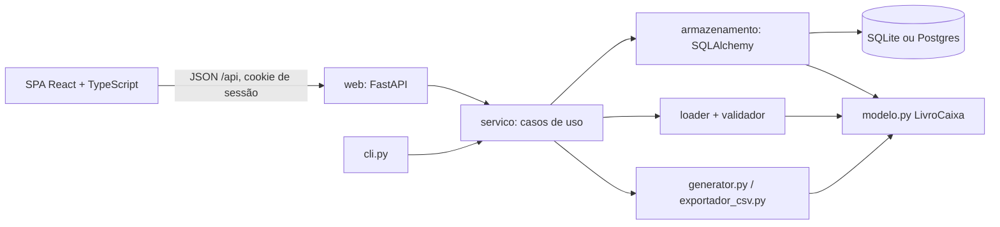

# Design: interface web

Rascunho, para aprovação. Cobre `interface-web` (WEB) e `armazenamento` (STO).

## Visão geral



Princípio: o domínio (`modelo.py`) e as saídas (`generator.py`, `exportador_csv.py`) **não mudam**. O repositório lê do banco e monta um `LivroCaixa`; daí planilha, CSV e totais saem do mesmo código de hoje (WEB-11, STO-10).

## Estrutura de pastas

```text
src/controlegastos/
  servico.py          # casos de uso, sem FastAPI nem SQLAlchemy nos tipos de entrada/saída
  armazenamento/      # modelos SQLAlchemy, repositório, migrações (Alembic)
  web/                # app FastAPI: rotas, auth, esquemas Pydantic, serve a SPA já compilada
frontend/             # app Vite (React + TypeScript); build copiado para src/controlegastos/web/static
Dockerfile            # imagem única (build do front + back)
```

Dependências do back-end ficam num extra opcional `web` do `pyproject.toml` (FastAPI, uvicorn, SQLAlchemy, Alembic, pwdlib[argon2], python-multipart), para a CLI continuar leve. Resolvem em Python 3.14 (verificado com `uv pip install --dry-run`; falta instalar de verdade na fase 3).

## Camada de serviço

Extrai da CLI o que a web também precisa: carregar/validar, calcular, gerar. Mudanças necessárias:

- `gerar_planilha` e `exportar_csv` ganham variantes que devolvem **bytes** (openpyxl salva em `BytesIO`; CSV em `StringIO`), mantendo as funções por caminho.
- Os dados dos gráficos (`_patrimonio_acumulado`, `_ranking_despesas`, `_variacao_saldo`) viram funções públicas em um módulo de resumo (`resumo.py`), usadas pela planilha **e** pela API (WEB-10, WEB-11).
- A CLI passa a chamar o serviço; comportamento externo idêntico (testes existentes continuam verdes).

## API (esboço)

| Método e rota | Função | Requisitos |
|---|---|---|
| `POST /api/auth/login`, `POST /api/auth/logout`, `GET /api/me` | Sessão | WEB-01, 03, 04 |
| `GET /api/meses/{ano}/{mes}` | Lançamentos, totais, salário e meta | WEB-06, 09 |
| `PUT /api/meses/{ano}/{mes}` | Salário e meta | WEB-07 |
| `POST /api/lancamentos`, `PATCH`/`DELETE /api/lancamentos/{id}` | CRUD | WEB-05, 08 |
| `GET /api/anos/{ano}/resumo` | Resumo mensal e dados dos gráficos | WEB-10 |
| `GET /api/exportar/{xlsx\|csv\|json}` | Downloads em memória | WEB-12, 13 |
| `POST /api/importar/json` | Importação transacional | WEB-13, STO-08 |

Dinheiro vai e volta como texto decimal (WEB-17); erros de validação como lista `{caminho, mensagem}` (WEB-08).

## Armazenamento

- Tabelas: `usuario`, `mes` (usuário, ano, mês, salário e meta em centavos), `lancamento` (id, mes, tipo, descrição, valor em centavos, dia, categoria, tipo de investimento, ativo, origem).
- Valores em centavos inteiros (STO-02); conversão para `Decimal` só no repositório. Teste de propriedade: `Decimal` → centavos → `Decimal` é identidade para 2 casas.
- Migrações Alembic; comando `controlegastos banco atualizar` (STO-07).
- `user_id` em toda consulta, centralizado no repositório (STO-06), com teste que tenta ler dados de outro usuário.

## Segurança

- Argon2 via `pwdlib`; sessão assinada em cookie `HttpOnly`/`SameSite=Lax`/`Secure` (hospedado).
- Como a SPA é servida pela mesma origem da API, não há CORS em produção. CSRF: cabeçalho de token em operações que alteram dados, mais `SameSite`. Em desenvolvimento, o Vite faz proxy para a API.
- Limite de tentativas de login (WEB-03); segredos só por variáveis de ambiente (WEB-15).

## Front-end

Confirmado: React + TypeScript + Vite, TanStack Query para dados, React Router, gráficos com ECharts ou Recharts, cliente da API gerado com `openapi-typescript` (WEB-16). Testes: Vitest + Testing Library; ponta a ponta com Playwright contra o app real com SQLite temporário. Formatação BRL via `Intl.NumberFormat('pt-BR')` sobre o texto decimal recebido, sem fazer contas com `number` (WEB-11, WEB-17).

## Execução

- **Local** (WEB-14): `uv run controlegastos web` sobe uvicorn em `127.0.0.1` servindo API e arquivos estáticos; banco SQLite em pasta de dados do usuário.
- **Hospedado** (WEB-15): `docker build` em dois estágios (Node compila o front; Python instala com `--extra web`); `DATABASE_URL`, chave secreta e `COOKIE_SECURE` por ambiente; volume para o SQLite; HTTPS pelo proxy reverso.

## CI e agentes

- Novo job `web` com Node: lint, `tsc`, Vitest, build e conferência de que o cliente gerado do OpenAPI está em dia.
- `scripts/checar.py` passa a tratar `frontend/**` (lint e testes do arquivo editado) e o hook do Claude Code/Kiro cobre os dois lados.
- O `implementador` cobre back e front; criar um agente `frontend` só se isso ficar pesado.

## Riscos e mitigação

| Risco | Mitigação |
|---|---|
| Dois toolchains (Python e Node) aumentam a manutenção | Contrato único via OpenAPI + cliente gerado; um único processo e imagem em produção; fases pequenas |
| Cálculo duplicado no front diverge do back | WEB-11: o front só exibe; testes comparam API com `.xlsx`/CSV para os mesmos dados |
| Perda de precisão do dinheiro | Centavos inteiros no banco; texto decimal na API; nunca `float`/`number` em cálculo |
| Exposição indevida na internet | Login obrigatório mesmo no modo local, Argon2, limite de tentativas, HTTPS, sem cadastro público |
| SQLite com muitos acessos simultâneos | Adequado ao porte; `DATABASE_URL` permite Postgres sem mudar o domínio |
